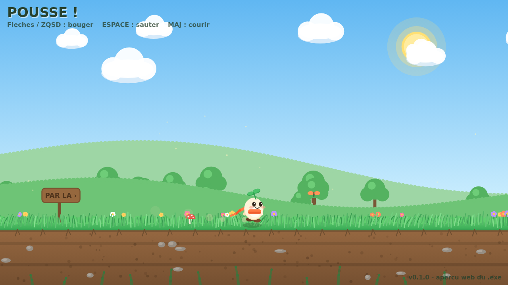

<p align="center">
  
</p>

# 🌱 Pousse ! — petit platformer (C# / .exe Windows)

Un platformer 2D en **C# + [Raylib](https://www.raylib.com/)**, compilé en **un seul `.exe` autonome** pour PC Windows.
Pour l'instant : un sol d'herbe très stylé (vent, rafales, l'herbe se plie quand tu passes dedans 🌾) et un petit perso avec des animations soignées (squash & stretch, course, écharpe qui flotte, pousse sur la tête qui rebondit…).



[](https://github.com/Snowoo-2z/gameexe/actions/workflows/build.yml)
[](https://github.com/Snowoo-2z/gameexe/releases/latest)

---

## 🎮 Jouer (Windows) — installation en 1 double-clic

1. Télécharge **[Installer.bat](https://github.com/Snowoo-2z/gameexe/releases/latest/download/Installer.bat)** (depuis la dernière Release)
2. **Double-clique dessus** → il télécharge le jeu depuis GitHub, l'installe, crée un raccourci sur ton **Bureau** et dans le **menu Démarrer**, puis Lance le jeu. Aucun droit administrateur requis.

> 💡 Tu peux aussi télécharger **[GameExe.exe](https://github.com/Snowoo-2z/gameexe/releases/latest/download/GameExe.exe)** directement : c'est un seul fichier autonome, double-clic et ça joue.

### Contrôles

| Action | Touches |
|---|---|
| Bouger | `←` `→` ou `Q` / `D` (ZQSD & WASD acceptés) |
| Sauter | `Espace`, `↑`, `Z` ou `W` — relâche tôt pour un petit saut |
| Courir | `Maj` (Shift) |
| Plein écran | `F` ou `F11` |
| Capture d'écran | `P` (enregistre `capture.png`) |
| Appliquer une mise à jour | `Entrée` (quand le bandeau orange apparaît) |
| Quitter | `Échap` |

---

## 🔄 Mises à jour automatiques (depuis GitHub)

Le système d'update fonctionne de **3 façons complémentaires** :

1. **Dans le jeu** : à chaque démarrage, le jeu demande en arrière-plan à l'API GitHub quelle est la dernière version. Si elle est plus récente, il télécharge le nouvel `.exe` tout seul et affiche un bandeau : **`Entrée`** → l'exe est remplacé et le jeu se relance. Hors-ligne ? Le jeu démarre normalement, sans rien dire.
2. **Via `Installer.bat`** : le relancer met le jeu à jour (il compare les versions). Il récupère toujours la dernière version du script d'installation depuis le repo.
3. **Désinstaller** : `Desinstaller.bat` (supprime le jeu + les raccourcis).

### 📦 Publier une nouvelle version (pour le développeur)

C'est **100 % automatisé par GitHub Actions** :

1. Change le numéro dans **[version.txt](version.txt)** (ex. `0.1.0` → `0.2.0`)
2. Commit + push sur **`main`** (ou merge ta PR)
3. Le workflow **[Release](.github/workflows/release.yml)** fabrique le `.exe` sur un PC Windows chez GitHub et publie la Release `vX.Y.Z` avec `GameExe.exe`, le `.zip`, `Installer.bat` et `version.json`
4. Tous les joueurs reçoivent la mise à jour à leur prochain lancement ✨

*(Un tag `vX.Y.Z` fait la même chose. Le workflow **[Build](.github/workflows/build.yml)**, lui, compile à chaque push pour vérifier que rien n'est cassé, et dépose l'exe en artifact téléchargeable dans l'onglet Actions.)*

---

## ⚙️ Activation unique des workflows GitHub (2 minutes, une seule fois)

GitHub interdit aux applications tierces de créer des fichiers dans `.github/workflows/`.
Le propriétaire du repo doit donc les créer **une seule fois** (après, tout est automatique) :

1. **[Créer `.github/workflows/build.yml`](https://github.com/Snowoo-2z/gameexe/new/main?filename=.github/workflows/build.yml&value=%23%20Compilation%20de%20verification%20%3A%20a%20chaque%20push%2C%20on%20fabrique%20le%20.exe%0A%23%20pour%20verifier%20que%20le%20code%20compile.%20L%27exe%20est%20dispo%20en%20%22artifact%22%0A%23%20en%20bas%20de%20la%20page%20du%20run%20%28onglet%20Actions%20du%20repo%29.%0Aname%3A%20Build%0A%0Aon%3A%0A%20%20push%3A%0A%20%20pull_request%3A%0A%20%20workflow_dispatch%3A%0A%0Ajobs%3A%0A%20%20build-windows%3A%0A%20%20%20%20runs-on%3A%20windows-latest%0A%20%20%20%20steps%3A%0A%20%20%20%20%20%20-%20uses%3A%20actions/checkout%40v4%0A%0A%20%20%20%20%20%20-%20uses%3A%20actions/setup-dotnet%40v4%0A%20%20%20%20%20%20%20%20with%3A%0A%20%20%20%20%20%20%20%20%20%20dotnet-version%3A%20%278.0.x%27%0A%0A%20%20%20%20%20%20-%20name%3A%20Lire%20la%20version%20%28version.txt%29%0A%20%20%20%20%20%20%20%20shell%3A%20pwsh%0A%20%20%20%20%20%20%20%20run%3A%20%7C%0A%20%20%20%20%20%20%20%20%20%20%24v%20%3D%20%28Get-Content%20version.txt%20-Raw%29.Trim%28%29%0A%20%20%20%20%20%20%20%20%20%20%22VERSION%3D%24v%22%20%7C%20Out-File%20-FilePath%20%24env%3AGITHUB_ENV%20-Append%0A%20%20%20%20%20%20%20%20%20%20Write-Host%20%22Version%20%3A%20%24v%22%0A%0A%20%20%20%20%20%20-%20name%3A%20Fabriquer%20GameExe.exe%20%28un%20seul%20fichier%20autonome%29%0A%20%20%20%20%20%20%20%20shell%3A%20pwsh%0A%20%20%20%20%20%20%20%20run%3A%20%3E%0A%20%20%20%20%20%20%20%20%20%20dotnet%20publish%20src/GameExe/GameExe.csproj%0A%20%20%20%20%20%20%20%20%20%20-c%20Release%20-r%20win-x64%20--self-contained%20true%0A%20%20%20%20%20%20%20%20%20%20-p%3APublishSingleFile%3Dtrue%0A%20%20%20%20%20%20%20%20%20%20-p%3AIncludeNativeLibrariesForSelfExtract%3Dtrue%0A%20%20%20%20%20%20%20%20%20%20-p%3AVersion%3D%24env%3AVERSION%0A%20%20%20%20%20%20%20%20%20%20-p%3AInformationalVersion%3D%24env%3AVERSION%0A%20%20%20%20%20%20%20%20%20%20-o%20dist%0A%0A%20%20%20%20%20%20-%20name%3A%20Publier%20l%27exe%20comme%20artifact%20telechargeable%0A%20%20%20%20%20%20%20%20uses%3A%20actions/upload-artifact%40v4%0A%20%20%20%20%20%20%20%20with%3A%0A%20%20%20%20%20%20%20%20%20%20name%3A%20GameExe-win-x64%0A%20%20%20%20%20%20%20%20%20%20path%3A%20dist/GameExe.exe%0A)** → le contenu est pré-rempli → bouton **« Commit changes »**
2. **[Créer `.github/workflows/release.yml`](https://github.com/Snowoo-2z/gameexe/new/main?filename=.github/workflows/release.yml&value=%23%20Publication%20automatique%20d%27une%20Release%20GitHub%20contenant%20le%20.exe.%0A%23%0A%23%20Declencheurs%20%3A%0A%23%20%20%20-%20chaque%20push%20sur%20main%20%20-%3E%20la%20release%20v%3Cversion.txt%3E%20est%20%28re%29publiee%0A%23%20%20%20-%20un%20tag%20vX.Y.Z%0A%23%20%20%20-%20manuellement%20%28onglet%20Actions%20%3E%20Release%20%3E%20Run%20workflow%29%0A%23%0A%23%20C%27est%20cette%20release%20que%20Installer.bat%20et%20l%27auto-update%20du%20jeu%0A%23%20vont%20chercher.%20Pour%20sortir%20une%20nouvelle%20version%20%3A%20change%20le%0A%23%20numero%20dans%20version.txt%2C%20commit%2C%20push%20sur%20main.%20C%27est%20tout%20%21%0Aname%3A%20Release%0A%0Aon%3A%0A%20%20push%3A%0A%20%20%20%20branches%3A%20%5Bmain%5D%0A%20%20%20%20tags%3A%20%5B%27v%2A%27%5D%0A%20%20workflow_dispatch%3A%0A%0Apermissions%3A%0A%20%20contents%3A%20write%0A%0Ajobs%3A%0A%20%20release%3A%0A%20%20%20%20runs-on%3A%20windows-latest%0A%20%20%20%20steps%3A%0A%20%20%20%20%20%20-%20uses%3A%20actions/checkout%40v4%0A%0A%20%20%20%20%20%20-%20uses%3A%20actions/setup-dotnet%40v4%0A%20%20%20%20%20%20%20%20with%3A%0A%20%20%20%20%20%20%20%20%20%20dotnet-version%3A%20%278.0.x%27%0A%0A%20%20%20%20%20%20-%20name%3A%20Lire%20la%20version%20%28version.txt%29%0A%20%20%20%20%20%20%20%20shell%3A%20pwsh%0A%20%20%20%20%20%20%20%20run%3A%20%7C%0A%20%20%20%20%20%20%20%20%20%20%24v%20%3D%20%28Get-Content%20version.txt%20-Raw%29.Trim%28%29%0A%20%20%20%20%20%20%20%20%20%20%22VERSION%3D%24v%22%20%7C%20Out-File%20-FilePath%20%24env%3AGITHUB_ENV%20-Append%0A%20%20%20%20%20%20%20%20%20%20Write-Host%20%22Version%20%3A%20%24v%22%0A%0A%20%20%20%20%20%20-%20name%3A%20Fabriquer%20GameExe.exe%20%28un%20seul%20fichier%20autonome%29%0A%20%20%20%20%20%20%20%20shell%3A%20pwsh%0A%20%20%20%20%20%20%20%20run%3A%20%3E%0A%20%20%20%20%20%20%20%20%20%20dotnet%20publish%20src/GameExe/GameExe.csproj%0A%20%20%20%20%20%20%20%20%20%20-c%20Release%20-r%20win-x64%20--self-contained%20true%0A%20%20%20%20%20%20%20%20%20%20-p%3APublishSingleFile%3Dtrue%0A%20%20%20%20%20%20%20%20%20%20-p%3AIncludeNativeLibrariesForSelfExtract%3Dtrue%0A%20%20%20%20%20%20%20%20%20%20-p%3AVersion%3D%24env%3AVERSION%0A%20%20%20%20%20%20%20%20%20%20-p%3AInformationalVersion%3D%24env%3AVERSION%0A%20%20%20%20%20%20%20%20%20%20-o%20dist%0A%0A%20%20%20%20%20%20-%20name%3A%20Preparer%20les%20fichiers%20de%20la%20release%20%28zip%20%2B%20version.json%29%0A%20%20%20%20%20%20%20%20shell%3A%20pwsh%0A%20%20%20%20%20%20%20%20run%3A%20%7C%0A%20%20%20%20%20%20%20%20%20%20%24v%20%3D%20%24env%3AVERSION%0A%20%20%20%20%20%20%20%20%20%20Compress-Archive%20-Force%20-Path%20dist/GameExe.exe%2C%20Installer.bat%2C%20Desinstaller.bat%20-DestinationPath%20dist/GameExe-win-x64.zip%0A%20%20%20%20%20%20%20%20%20%20%40%7B%20version%20%3D%20%24v%3B%20exe%20%3D%20%27GameExe.exe%27%3B%20repo%20%3D%20%27Snowoo-2z/gameexe%27%20%7D%20%7C%20ConvertTo-Json%20%7C%0A%20%20%20%20%20%20%20%20%20%20%20%20Out-File%20-Encoding%20utf8%20dist/version.json%0A%20%20%20%20%20%20%20%20%20%20Copy-Item%20Installer.bat%20dist/Installer.bat%0A%20%20%20%20%20%20%20%20%20%20Get-ChildItem%20dist%0A%0A%20%20%20%20%20%20-%20name%3A%20Publier%20la%20Release%20GitHub%0A%20%20%20%20%20%20%20%20uses%3A%20softprops/action-gh-release%40v2%0A%20%20%20%20%20%20%20%20with%3A%0A%20%20%20%20%20%20%20%20%20%20tag_name%3A%20v%24%7B%7B%20env.VERSION%20%7D%7D%0A%20%20%20%20%20%20%20%20%20%20name%3A%20Pousse%20%21%20v%24%7B%7B%20env.VERSION%20%7D%7D%0A%20%20%20%20%20%20%20%20%20%20body%3A%20%7C%0A%20%20%20%20%20%20%20%20%20%20%20%20%23%23%20%F0%9F%8E%AE%20Pour%20jouer%20%28Windows%29%0A%20%20%20%20%20%20%20%20%20%20%20%201.%20T%C3%A9l%C3%A9charge%20%2A%2A%60Installer.bat%60%2A%2A%20ci-dessous%0A%20%20%20%20%20%20%20%20%20%20%20%202.%20Double-clique%20dessus%20%E2%86%92%20le%20jeu%20s%27installe%2C%20un%20raccourci%20appara%C3%AEt%20sur%20ton%20Bureau%2C%20et%20le%20jeu%20se%20Lance%0A%20%20%20%20%20%20%20%20%20%20%20%203.%20Les%20mises%20%C3%A0%20jour%20sont%20ensuite%20%2A%2Aautomatiques%2A%2A%20%3A%20le%20jeu%20v%C3%A9rifie%20au%20d%C3%A9marrage%20%28touche%20ENTREE%20pour%20appliquer%29%2C%20ou%20relance%20%60Installer.bat%60%0A%0A%20%20%20%20%20%20%20%20%20%20%20%20%3E%20Tu%20peux%20aussi%20prendre%20%60GameExe.exe%60%20directement%20%3A%20c%27est%20un%20seul%20fichier%20autonome%2C%20rien%20%C3%A0%20installer.%0A%0A%20%20%20%20%20%20%20%20%20%20%20%20%2A%2AContr%C3%B4les%2A%2A%20%3A%20fl%C3%A8ches%20/%20ZQSD%20pour%20bouger%20%C2%B7%20ESPACE%20pour%20sauter%20%C2%B7%20MAJ%20pour%20courir%20%C2%B7%20F%20plein%20%C3%A9cran%20%C2%B7%20ECHAP%20quitter%0A%20%20%20%20%20%20%20%20%20%20files%3A%20%7C%0A%20%20%20%20%20%20%20%20%20%20%20%20dist/GameExe.exe%0A%20%20%20%20%20%20%20%20%20%20%20%20dist/GameExe-win-x64.zip%0A%20%20%20%20%20%20%20%20%20%20%20%20dist/Installer.bat%0A%20%20%20%20%20%20%20%20%20%20%20%20dist/version.json%0A%20%20%20%20%20%20%20%20%20%20fail_on_unmatched_files%3A%20true%0A)** → le contenu est pré-rempli → bouton **« Commit changes »**

> Si le contenu ne s'affiche pas tout seul : ouvre les fichiers dans le dossier [`github-workflows/`](github-workflows/) du repo, copie leur contenu, et colle-le dans l'éditeur.

Dès le 2ᵉ commit, GitHub fabrique **`GameExe.exe`** et publie la **Release v0.1.0** tout seul (onglet **Actions** pour suivre, ~2 minutes). Ensuite, pour chaque nouvelle version : voir « Publier une nouvelle version » plus haut.

---

## 🛠️ Développer

Prérequis : **[.NET SDK 8](https://dotnet.microsoft.com/download)** (Windows, gratuit).

```bat
dev.bat      :: Lance le jeu depuis le code source (mode dev, sans auto-update)
build.bat    :: Fabrique dist\GameExe.exe localement (même chose que GitHub Actions)
```

Équivalent en ligne de commande :

```bash
dotnet run --project src/GameExe                       # lancer en dev
dotnet publish src/GameExe -c Release -r win-x64 --self-contained -p:PublishSingleFile=true -o dist
```

> 🐧🍎 Le code est multi-plateforme (Raylib) : `dotnet run` fonctionne aussi sur Linux/macOS pour développer. Seul l'exe publié est Windows pour l'instant.

### Structure du projet

```
gameexe/
├── version.txt                  ← LA version du jeu (source unique de vérité)
├── Installer.bat                ← installe / met à jour depuis GitHub (joueurs)
├── Desinstaller.bat
├── build.bat  / dev.bat         ← build local / lancement dev
├── tools/installer.ps1          ← le vrai script d'installation (PowerShell)
├── .github/workflows/
│   ├── build.yml                ← compile le .exe à chaque push (vérification)
│   └── release.yml              ← publie la Release GitHub automatiquement
├── src/GameExe/
│   ├── Program.cs               ← fenêtre, boucle de jeu, caméra, HUD
│   ├── Player.cs                ← physique + TOUTES les animations du perso
│   ├── World.cs                 ← ciel, collines, terre, herbe animée, décor
│   ├── Particles.cs             ← poussière, brins d'herbe, onde d'impact
│   ├── Updater.cs               ← vérification GitHub + application de l'update
│   └── GameInfo.cs / Utils.cs
├── preview/index.html           ← aperçu web jouable (jumeau JS du jeu, pour tester vite)
└── assets/                      ← logo + icône
```

**Aucune image n'est utilisée en jeu** : tout (perso, herbe, nuages, papillons…) est dessiné avec des formes et animé en code — c'est pour ça que l'exe tient en un seul fichier sans aucun dossier d'assets.

### Détails d'animation implémentés

- **Perso** : squash & stretch à ressorts (saut/atterrissage dosés selon l'impact), respiration au repos, clignements, regard qui suit le mouvement, bouche « o » en chute, bras qui moulinent, cycle de course, inclinaison du corps, écharpe ondulante à segments, pousse sur ressort, poussière de dérapage/course, onde + herbe arrachée à l'atterrissage.
- **Game feel** : *coyote time*, *jump buffering*, saut à hauteur variable, caméra douce avec anticipation.
- **Herbe** : ~800 brins en 2 couches, vent + rafales voyageuses, **les brins s'écartent au passage du perso** ; fleurs, champignons, pollen, papillons, parallaxe (collines, arbres, nuages, herbe de premier plan).

---

## 🗺️ Idées pour la suite

- [ ] Plateformes (sauter dessus), puis plusieurs niveaux
- [ ] Pièces / graines à ramasser + compteur
- [ ] Ennemis (limaces ?) et rebond sur la tête
- [ ] Sons générés en code (saut, ramassage) + petite musique
- [ ] Double-saut / dash
- [ ] Menu titre et sauvegarde des meilleurs temps

---

*Fait avec C# 12 · .NET 8 · Raylib-cs 7.0.2 · GitHub Actions*
